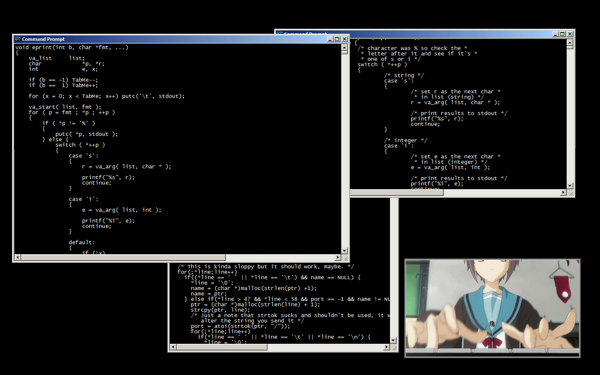

# ULTRAVIOLENCE VTxИТМО ✅

// Если пригодился мой репозиторий — вдави звездочку ✅

    ! Любое копирование материала без указания автора приравнивается к плагату !

Этот репозиторий содержит мои наработки (лабы / домашки / etc) за время обучения на факультете Системного и Прикладного Программного Обеспечения (СППО) в университете ИТМО :nerd_face:

# Предметы :book:
<pre>
📚 VT
├── 🍼 1 семестр
│   ├── <a href="https://github.com/Vaneshik/VT-Labs/tree/main/java">Программирование (ПРОГА)</a>
│   │   ├── <a href="https://github.com/Vaneshik/VT-Labs/tree/main/java/lab1">Лаба 1</a>
│   │   ├── <a href="https://github.com/Vaneshik/VT-Labs/tree/main/java/lab2">Лаба 2</a>
│   │   ├── <a href="https://github.com/Vaneshik/VT-Labs/tree/main/java/lab3">Лаба 3</a>
│   │   └── <a href="https://github.com/Vaneshik/VT-Labs/tree/main/java/lab4">Лаба 4</a>
│   ├── <a href="https://github.com/Vaneshik/VT-Labs/tree/main/opd">Основы Профессиональной деятельности (ОПД)</a>
│   │   ├── <a href="https://github.com/Vaneshik/VT-Labs/tree/main/opd/lab1">Лаба 1</a>
│   │   └── <a href="https://github.com/Vaneshik/VT-Labs/tree/main/opd/lab2">Лаба 2</a>
│   └── <a href="https://github.com/Vaneshik/VT-Labs/tree/main/informatics">Информатика (ИНФА)</a>
│       ├── <a href="https://github.com/Vaneshik/VT-Labs/tree/main/informatics/lab1">Лаба 1</a>
│       ├── <a href="https://github.com/Vaneshik/VT-Labs/tree/main/informatics/lab2">Лаба 2</a>
│       ├── <a href="https://github.com/Vaneshik/VT-Labs/tree/main/informatics/lab3">Лаба 3</a>
│       ├── <a href="https://github.com/Vaneshik/VT-Labs/tree/main/informatics/lab4">Лаба 4</a>
│       ├── <a href="https://github.com/Vaneshik/VT-Labs/tree/main/informatics/lab5">Лаба 5</a>
│       └── <a href="https://github.com/Vaneshik/VT-Labs/tree/main/informatics/lab6">Лаба 6</a>
│
├── 🎓 2 семестр
│   ├── <a href="https://github.com/Vaneshik/VT-Labs/tree/main/java">Программирование (ПРОГА)</a>
│   │   ├── <a href="https://github.com/Vaneshik/VT-Labs/tree/main/java/lab5">Лаба 5</a>
│   │   ├── <a href="https://github.com/Vaneshik/VT-Labs/tree/main/java/lab6">Лаба 6</a>
│   │   └── <a href="https://www.youtube.com/watch?v=dQw4w9WgXcQ">Лаба 7</a>
│   ├── <a href="https://github.com/Vaneshik/VT-Labs/tree/main/opd">Основы Профессиональной деятельности (ОПД)</a>
│   │   ├── <a href="https://github.com/Vaneshik/VT-Labs/tree/main/opd/lab3">Лаба 3</a>
│   │   ├── <a href="https://github.com/Vaneshik/VT-Labs/tree/main/opd/lab4">Лаба 4</a>
│   │   ├── <a href="https://github.com/Vaneshik/VT-Labs/tree/main/opd/lab5">Лаба 5</a>
│   │   ├── <a href="https://github.com/Vaneshik/VT-Labs/tree/main/opd/lab6">Лаба 6</a>
│   │   └── <a href="https://github.com/Vaneshik/VT-Labs/tree/main/opd/lab7">Лаба 7</a>
│   └── <a href="https://github.com/Vaneshik/VT-Labs/tree/main/bd">Базы данных (БД)</a>
│       ├── <a href="https://github.com/Vaneshik/VT-Labs/tree/main/bd/lab1">Лаба 1</a>
│       ├── <a href="https://github.com/Vaneshik/VT-Labs/tree/main/bd/lab2">Лаба 2</a>
│       ├── <a href="https://github.com/Vaneshik/VT-Labs/tree/main/bd/lab3">Лаба 3</a>
│       └── <a href="https://github.com/Vaneshik/VT-Labs/tree/main/bd/lab4">Лаба 4</a>
│
├── 📖 3 семестр
│   ├── <a href="https://github.com/Vaneshik/VT-Labs/tree/main/web">Веб-программирование (WEB)</a>
│   │   ├── <a href="https://github.com/Vaneshik/VT-Labs/tree/main/web/lab1">Лаба 1</a>
│   │   ├── <a href="https://github.com/Vaneshik/VT-Labs/tree/main/web/lab2">Лаба 2</a>
│   │   ├── <a href="https://github.com/Vaneshik/VT-Labs/tree/main/web/lab3">Лаба 3</a>
│   │   └── <a href="https://github.com/Vaneshik/VT-Labs/tree/main/web/lab4">Лаба 4</a>
│   └── <a href="https://github.com/Vaneshik/VT-Labs/tree/main/llp">Языки Программирования (ЯПЫ)</a>
│       ├── <a href="https://github.com/Vaneshik/VT-Labs/tree/main/llp/assignment-1-io-library">Лаба 1</a>
│       ├── <a href="https://github.com/Vaneshik/VT-Labs/tree/main/llp/assignment-2-dictionary">Лаба 2</a>
│       ├── <a href="https://github.com/Vaneshik/VT-Labs/tree/main/llp/assignment-3-image-transform">Лаба 3</a>
│       ├── <a href="https://github.com/Vaneshik/VT-Labs/tree/main/llp/assignment-4-memory-allocator">Лаба 4</a>
│       └── <a href="https://stepik.org/course/73618">Курс на Stepik</a>
│
├── 📂 4 семестр
│   ├── <a href="https://github.com/Vaneshik/VT-Labs/tree/main/algo">Алгоритмы и Структуры Данных (АЛГОСЫ)</a>
│   ├── <a href="https://github.com/Vaneshik/VT-Labs/tree/main/archcomp">Архитектура компьютера (АК)</a>
│   ├── <a href="https://github.com/Vaneshik/VT-Labs/tree/main/opi">Основы программной инженерии (ОПИ)</a>
│   └── <a href="https://github.com/Vaneshik/VT-Labs/tree/main/comp_math">Вычислительная математика (ВЫЧМАТ)</a>
│       ├── <a href="https://github.com/Vaneshik/VT-Labs/tree/main/comp_math/comp_math1">Лаба 1</a>
│       ├── <a href="https://github.com/Vaneshik/VT-Labs/tree/main/comp_math/comp_math2">Лаба 2</a>
│       ├── <a href="https://github.com/Vaneshik/VT-Labs/tree/main/comp_math/comp_math3">Лаба 3</a>
│       └── <a href="https://github.com/Vaneshik/VT-Labs/tree/main/comp_math/comp_math4">Лаба 4</a>
│
├── 🔬 5 семестр
│   ├── <a href="https://github.com/Vaneshik/VT-Labs/tree/main/fp">Функциональное программирование (ФП)</a>
│   │   ├── <a href="https://github.com/Vaneshik/VT-Labs/tree/main/fp/lab1">Лаба 1</a>
│   │   ├── <a href="https://github.com/Vaneshik/VT-Labs/tree/main/fp/lab2">Лаба 2</a>
│   │   ├── <a href="https://github.com/Vaneshik/VT-Labs/tree/main/fp/lab3">Лаба 3</a>
│   │   └── <a href="https://github.com/Vaneshik/VT-Labs/tree/main/fp/lab4">Лаба 4</a>
│   ├── <a href="https://github.com/Vaneshik/VT-Labs/tree/main/is">Информационные системы (ИС)</a>
│   │   ├── <a href="https://github.com/Vaneshik/VT-Labs/tree/main/is/lab1">Лаба 1</a>
│   │   ├── <a href="https://github.com/Vaneshik/VT-Labs/tree/main/is/lab2">Лаба 2</a>
│   │   └── <a href="https://github.com/Vaneshik/VT-Labs/tree/main/is/lab3">Лаба 3</a>
│   └── <a href="https://github.com/Vaneshik/VT-Labs/tree/main/os">Операционные системы (ОС)</a>
│       └── <a href="https://github.com/Vaneshik/VT-Labs/tree/main/os/lab4">Лаба 4</a>
│
├── ⚙️ 6 семестр
│   ├── <a href="https://github.com/Vaneshik/VT-Labs/tree/main/tpo">Тестирование программного обеспечения (ТПО)</a>
│   │   ├── <a href="https://github.com/Vaneshik/VT-Labs/tree/main/tpo/lab1">Лаба 1</a>
│   │   ├── <a href="https://github.com/Vaneshik/VT-Labs/tree/main/tpo/lab2">Лаба 2</a>
│   │   ├── <a href="https://github.com/Vaneshik/VT-Labs/tree/main/tpo/lab3">Лаба 3</a>
│   │   └── <a href="https://github.com/Vaneshik/VT-Labs/tree/main/tpo/lab4">Лаба 4</a>
│   └── <a href="https://github.com/Vaneshik/VT-Labs/tree/main/rshd">Распределённые системы хранения данных (РСХД)</a>
│       ├── <a href="https://github.com/Vaneshik/VT-Labs/tree/main/rshd/lab1">Лаба 1</a>
│       └── <a href="https://github.com/Vaneshik/VT-Labs/tree/main/rshd/lab2">Лаба 2</a>
│
├── 🖥️ 7 семестр
|   └── Дожить бы 🥶
│
└── 🎯 8 семестр
    └── Дожить бы 🥶
</pre>

# Полезные ссылки :mag_right:

* [Мой коллега федор монтанович](https://github.com/2BuRy1)
* [Гайд на первый курс от IMTJL](https://github.com/Imtjl/1st-year-guide)
* [Гайд на второй курс IMTJL](https://github.com/Imtjl/2t-year-guide)
